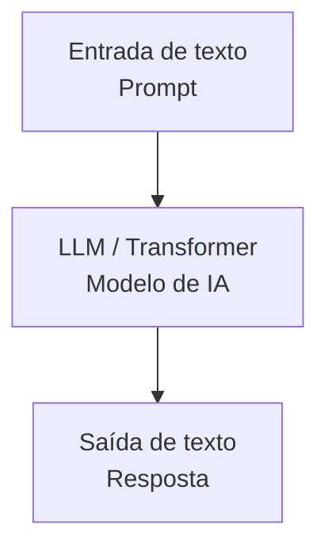
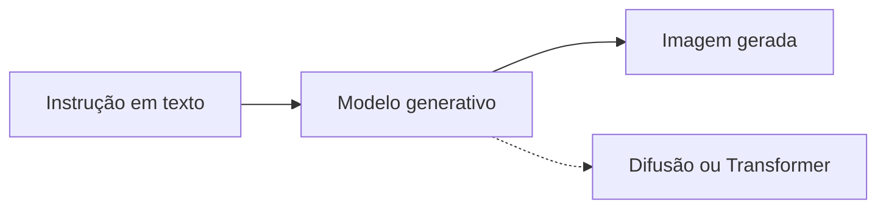

---
layout: post
title: "A história da inteligência artificial"
date: 2026-09-10 12:00:00 +0000
categories: [Inteligência Artificial, História]
tags: [inteligencia-artificial, historia, tecnologia, aprendizado-de-maquina]
description: "Conheça a evolução da inteligência artificial: das ideias de Alan Turing à era da IA generativa."
lang: pt-BR
author: marcos
image:
  path: /assets/img/posts/history-of-ai/cover.jpg
  alt: "A história da inteligência artificial"
published: true
---

<a href="https://commons.wikimedia.org/wiki/File:Is_artificial_intelligence_our_future.jpg">Elekes Andor</a>, <a href="https://creativecommons.org/licenses/by-sa/4.0">CC BY-SA 4.0</a>, via Wikimedia Commons

> “A verdadeira questão não é se as máquinas pensam, mas se os seres humanos pensam.”
> — *B. F. Skinner*

A **história da inteligência artificial** é uma das jornadas mais fascinantes da humanidade — um campo que combina ciência, filosofia e imaginação.
Ela começa muito antes dos computadores modernos, com pensadores e escritores que ousaram imaginar máquinas capazes de pensar.

---

## 🧭 Linha do tempo da inteligência artificial

<strong>1642 – Calculadora mecânica</strong> 
Blaise Pascal inventa a Pascalina, uma das primeiras calculadoras mecânicas.

<strong>1921 – O termo “robô”</strong> 
Karel Čapek introduz a palavra “robô”, que influenciaria a literatura futurista.

<strong>1943 – Modelos formais de neurônios</strong> 
McCulloch e Pitts publicam o primeiro modelo funcional de um neurônio artificial.

<strong>1950 – Inteligência de máquina e robótica</strong> 
Alan Turing publica seu trabalho sobre inteligência de máquina; Asimov publica as Três Leis da Robótica.

<strong>1956 – Conferência de Dartmouth</strong> 
John McCarthy formaliza o termo “inteligência artificial”.

<strong>1970–1980 – Inverno da IA</strong> 
Primeiro período de cortes de financiamento e redução do interesse científico.

<strong>Anos 1980 – Sistemas especialistas</strong> 
Aplicações avançadas de lógica progridem na medicina e na engenharia.

<strong>1997 – Deep Blue</strong> 
A IA da IBM vence Garry Kasparov no xadrez.

<strong>2011 – IBM Watson</strong> 
Watson vence o Jeopardy! usando processamento de linguagem natural e aprendizado de máquina.

<strong>2012 – Aprendizado profundo</strong> 
AlexNet revoluciona a visão computacional.

<strong>2016 – AlphaGo</strong> 
AlphaGo vence o campeão mundial de Go.

<strong>2022 – IA generativa</strong> 
Modelos como o ChatGPT popularizam a IA.

---

### 🌐 A história da inteligência artificial: da mitologia à realidade
A inteligência artificial (IA) parece ser a tecnologia que define nossa época, mas sua história é muito mais antiga e fascinante do que muita gente imagina. Não se trata de uma invenção recente, e sim de uma área de estudo que atravessou décadas de avanços e retrocessos até se tornar uma força transformadora.

Esta é a história das tentativas da humanidade de reproduzir uma de suas capacidades mais extraordinárias: a mente humana.

#### As raízes da IA antes dos computadores

Muito antes dos primeiros computadores, a imaginação humana já concebia seres artificiais capazes de pensar.

* **Mito e filosofia:** a Grécia Antiga contava histórias de autômatos como Talos, um gigante de bronze que protegia Creta. Filósofos como Aristóteles lançaram as bases da lógica formal, que mais tarde seria essencial para a IA.

<figure>

<figcaption>
    Estátua de Talos, o autômato de bronze da mitologia grega.
    Crédito: 4lkna — <a href="https://creativecommons.org/licenses/by/2.0/">CC BY 2.0</a>, via Flickr.
</figcaption>
</figure>

* **O sonho de uma máquina pensante:** no século XVII, pensadores como Gottfried Wilhelm Leibniz imaginaram uma “linguagem universal” que permitiria calcular a solução de qualquer problema. A máquina de calcular de Leibniz foi um dos primeiros dispositivos mecânicos capazes de executar automaticamente as quatro operações aritméticas — adição, subtração, multiplicação e divisão — por meio de um engenhoso tambor escalonado. Foi um passo importante rumo à ideia de que máquinas poderiam realizar raciocínios antes exclusivos dos seres humanos.

<figure>

<figcaption>
A máquina de calcular de Leibniz — CC BY-SA 4.0, via Wikimedia Commons.
</figcaption>
</figure>

---

## 🧩 As origens filosóficas da IA

A busca por máquinas inteligentes é antiga.

Da mitologia grega e de Talos ao autômato de Vaucanson, no século XVIII, as pessoas há muito tentam reproduzir artificialmente a vida.

Mas foi o matemático **Alan Turing** quem, em 1950, transformou esse sonho em ciência.

No artigo *Computing Machinery and Intelligence*, Turing propôs o famoso **Teste de Turing**, um experimento para avaliar se uma máquina poderia exibir um comportamento inteligente indistinguível do humano.
<figure>

<figcaption>Alan Turing — domínio público, via Wikimedia Commons.</figcaption>
</figure>

---

## 🤖 Asimov e as Três Leis da Robótica (1950)

Enquanto Turing escrevia sobre o pensamento das máquinas, o escritor e bioquímico **Isaac Asimov** criou histórias que moldaram o imaginário coletivo sobre robôs e inteligência artificial.

Em sua coletânea **“Eu, Robô”**, Asimov apresentou as **Três Leis da Robótica**, princípios éticos que inspiraram gerações de cientistas e engenheiros:

1. Um robô não pode ferir um ser humano nem, por omissão, permitir que um ser humano sofra algum mal.
2. Um robô deve obedecer às ordens dadas por seres humanos, exceto quando essas ordens entrarem em conflito com a Primeira Lei.
3. Um robô deve proteger a própria existência, desde que essa proteção não entre em conflito com a Primeira ou a Segunda Lei.

Essas leis anteciparam debates éticos reais sobre **autonomia de máquina** e **responsabilidade moral**, discussões que continuam atuais com os sistemas autônomos e a IA generativa.

_Isaac Asimov (por volta de 1959), autor de “Eu, Robô”. Domínio público, via Wikimedia Commons._

---

## 🧠 A era de ouro da IA (décadas de 1950 a 1970)

O verdadeiro “nascimento” da IA como campo formal de pesquisa ocorreu em meados do século XX, impulsionado pelo surgimento dos computadores.

* **Conferência de Dartmouth (1956):** o evento é amplamente considerado o marco de nascimento da IA. Organizado por John McCarthy, Marvin Minsky e outros pesquisadores, reuniu os principais pensadores da época. McCarthy cunhou o termo “inteligência artificial” durante o encontro.

_Retrato do professor John McCarthy (1927–2011) na Universidade Stanford, em 2006. Conhecido como um dos “pais da IA”, foi o principal organizador da Conferência de Dartmouth de 1956, marco da consolidação formal da área._

> “<i>A Conferência de Dartmouth de 1956 é amplamente considerada o evento fundador da inteligência artificial como campo de estudo.</i>”
<cite style="display: block; text-align: right; font-size: 0.9em; color: #666;">
  — <a href="https://spectrum.ieee.org/dartmouth-ai-workshop" target="_blank">IEEE Spectrum</a>
</cite>

> “<i>A Conferência de Dartmouth não apenas cunhou o termo ‘inteligência artificial’; ela unificou todo um campo de estudo. Foi como um Big Bang mítico da IA: tudo o que sabemos sobre aprendizado de máquina, redes neurais e aprendizado profundo remonta àquele verão em New Hampshire.</i>”
<cite style="display: block; text-align: right; font-size: 0.9em; color: #666; margin-top: 5px;">
  — <a href="https://spectrum.ieee.org/dartmouth-ai-workshop" target="_blank">IEEE Spectrum</a>
</cite>

---

O primeiro período da inteligência artificial, entre **1956 e 1974**, foi marcado pela **abordagem simbólica**. Essa metodologia buscava fazer os computadores processarem informações de forma lógica e simbólica, representando o conhecimento humano por meio de regras e estruturas.

Nesse período, programas pioneiros demonstraram o potencial da IA. O **Logic Theorist**, criado por Allen Newell e Herbert Simon em **1956**, foi uma das primeiras grandes conquistas da área: provava teoremas matemáticos automaticamente.

Em **1966**, Joseph Weizenbaum desenvolveu a **ELIZA**, um dos primeiros chatbots. Embora não compreendesse de fato uma conversa, a ELIZA simulava o diálogo de um psicoterapeuta com regras e reconhecimento de palavras-chave, criando a ilusão de compreensão humana.

<figure style="text-align: center;">
    
  <figcaption style="text-align: center; font-size: 0.9em; color: #666; margin-top: 5px;">
    Exemplo de uma conversa com ELIZA, um dos primeiros programas a simular um diálogo terapêutico e impressionar o público na década de 1960.
  </figcaption>
</figure>

---

## 🧩 Os “invernos da IA” e os sistemas especialistas (1970–1990)

<figure style="text-align: center;">
  
  <figcaption style="text-align: center; font-size: 0.9em; color: #666; margin-top: 5px;">
    A inteligência artificial enfrentou cortes de financiamento e perdeu interesse global.
     Imagem ilustrativa de John Ferguson — domínio público, via Wikimedia Commons.
  </figcaption>
</figure>

Promessas não cumpridas levaram aos períodos conhecidos como **invernos da IA**, marcados pela queda do entusiasmo e do financiamento.

Ainda assim, surgiram **sistemas especialistas** como o **MYCIN**, da Universidade Stanford, um precursor do raciocínio baseado em regras.

A empolgação inicial criou expectativas irreais de que as máquinas logo alcançariam a inteligência humana. Porém, a falta de avanços significativos em áreas como o **processamento de linguagem natural (PLN)** e a dificuldade de lidar com o **conhecimento de senso comum** levaram à frustração.

O principal corte de financiamento ocorreu em **1973**, após a publicação do **Relatório Lighthill** no Reino Unido, que criticou duramente a falta de resultados práticos nas pesquisas de IA. O financiamento do governo dos Estados Unidos, que sustentava boa parte dos estudos, foi drasticamente reduzido. A área entrou então em um período de estagnação conhecido como **primeiro inverno da IA**. Muitos pesquisadores deixaram o campo, e, nos círculos de financiamento, “inteligência artificial” passou a ser associada a promessas não cumpridas.

### 🧩 O renascimento dos sistemas especialistas (década de 1980)

_Representação visual de um sistema especialista — tecnologia que marcou o retorno da IA na década de 1980, antes do segundo inverno da IA. Crédito: Christophe Roche, CC BY-SA 4.0._

Apesar da crise, as pesquisas continuaram em aplicações mais práticas. A **retomada silenciosa** foi impulsionada pela comercialização dos **sistemas especialistas**.

Esses sistemas ganharam força no início da década de **1980** e representavam o conhecimento de especialistas — como médicos e engenheiros — por meio de milhares de regras lógicas. Eram caros, mas demonstraram valor em domínios específicos.

* **Marco importante:** o sistema **MYCIN**, desenvolvido a partir de 1972 e popularizado na década de 1980, auxiliava no diagnóstico de infecções sanguíneas e demonstrou o valor prático da IA. Empresas americanas e japonesas investiram bilhões em sistemas especialistas para aumentar a produtividade.

---

### 🧩 A mudança para o aprendizado de máquina (fim dos anos 1980 e início dos 1990)

Uma segunda onda de retomada veio com o novo foco em **aprendizado de máquina**. Pesquisadores deixaram de acreditar que a inteligência poderia ser programada inteiramente por regras e passaram a defender que as máquinas deveriam **aprender com dados**.

* **Marco importante:** o ressurgimento do **conexionismo (redes neurais)** no fim da década de 1980 e o desenvolvimento de algoritmos como a **retropropagação** prepararam o terreno para a era atual do **aprendizado profundo**. Esse trabalho matemático, ainda discreto, preparou a área para a explosão de dados e de capacidade computacional que viria na virada do século.

_Diagrama de um neurônio artificial._

---

## ♟️ 1997: Deep Blue vence Kasparov

Em 1997, o **Deep Blue**, da IBM, venceu o campeão mundial de xadrez **Garry Kasparov**.
Foi a primeira vez que uma máquina superou um ser humano em um domínio cognitivo complexo.

_Supercomputador Deep Blue, da IBM (1997). Crédito: IBM — domínio público._

---

## 💬 2011: IBM Watson — o início da IA cognitiva

Em **2011**, o sistema **IBM Watson** venceu o programa de perguntas e respostas **Jeopardy!**, superando campeões humanos e demonstrando o potencial da **IA cognitiva**.
Watson combinava **processamento de linguagem natural (PLN)** e **aprendizado de máquina** para compreender perguntas em linguagem natural e oferecer respostas contextualizadas.

Essa tecnologia abriu caminho para aplicações em:
- **Saúde** (diagnóstico clínico e pesquisa médica);
- **Finanças** (análise de riscos e automação);
- **Atendimento corporativo** (chatbots cognitivos).

_Logotipo do IBM Watson (2017). Crédito: IBM Corporation._

---

## 🌐 A era do aprendizado profundo e da IA generativa (2012–atualidade)

Após os chamados “invernos da IA” e o sucesso de sistemas baseados em regras, como o Deep Blue em 1997, a inteligência artificial entrou em um período de **renascimento acelerado**. Essa retomada não foi resultado de uma única ideia, mas da convergência de três fatores essenciais que tornaram viável a aplicação prática das redes neurais.

Em **2012**, a revolução do **aprendizado profundo** redefiniu a IA moderna.

Pesquisadores como **Geoffrey Hinton**, **Yoshua Bengio** e **Yann LeCun** demonstraram que redes neurais profundas superavam as abordagens tradicionais.

A partir de 2018, modelos de linguagem como **GPT**, **BERT** e **LLaMA** abriram caminho para a era da **IA generativa**, capaz de produzir textos, imagens e até código.

### 🌐 Os três pilares do aprendizado profundo

O sucesso do aprendizado profundo resultou da combinação dos seguintes avanços:

#### 1. Big data (o combustível)
* **Em detalhes:** o crescimento da internet, das redes sociais e do comércio eletrônico gerou grandes repositórios de dados. Modelos de aprendizado profundo dependem de muitos exemplos para aprender padrões complexos, uma escala inviável nas décadas de 1980 e 1990.
* **Marco:** a criação do conjunto de dados **ImageNet**, iniciada em 2009, reuniu mais de 14 milhões de imagens rotuladas e se tornou uma referência para algoritmos de visão computacional.

<figure>

    

        

        1995
    

    

        

        2005
    

    

        

        

        2015
    

    

        

        Hoje
    

<figcaption style="text-align: center; font-size: 0.9em; color: #777;">Crescimento ilustrativo do volume global de dados digitais; as alturas não representam medições.</figcaption>
</figure>

#### 2. Capacidade de processamento (o motor)
* **Em detalhes:** as unidades de processamento gráfico (**GPUs**), criadas originalmente para renderizar imagens, mostraram-se ideais para treinar redes neurais. Elas são eficientes em cálculos paralelos e repetitivos, essenciais para o algoritmo de **retropropagação**.
* **Impacto:** o treinamento de modelos que antes levava meses em CPUs tradicionais passou a levar dias ou horas em clusters de GPUs, viabilizando experimentação e iteração mais rápidas.

    

        <h3>CPU (unidade central de processamento)</h3>
        

            
C1

            
C2

            
C3

            
C4

            
C5
 
        

        

            Poucos núcleos, mas muito potentes.  Otimizados para tarefas complexas e sequenciais, como as de sistemas operacionais.
        

        
Cada quadrado azul representa um núcleo potente.

    

    

        <h3>GPU (unidade de processamento gráfico)</h3>
        

            

            

            

            

            

            

            

            

            

            

            

            

            

            

            

            

            

            

            

            

            

            

            

            

            

        

        

            Muitos núcleos, mais simples.  Otimizados para processar em paralelo tarefas repetitivas — uma característica útil no treinamento de IA.
        

        
Cada quadrado verde representa um núcleo mais simples.

    

#### 3. Algoritmos aprimorados (o guia)
* **Em detalhes:** pesquisadores resolveram problemas antigos das redes neurais, como o **problema do gradiente que desaparece**, que dificultava o treinamento de arquiteturas profundas. Soluções como a **ReLU** (unidade linear retificada) e novas arquiteturas ajudaram a superar essas limitações.
* **Arquiteturas importantes:**
    * **CNNs (redes neurais convolucionais):** essenciais para o processamento de imagens e a visão computacional.
    * **RNNs/LSTMs (redes neurais recorrentes/memória de longo e curto prazo):** úteis no processamento de sequências, como texto e séries temporais.

    

        <h3>CNN (rede neural convolucional)</h3>
        

            
Camada de entrada (imagem)

            
↓

            
Camada convolucional 1

            
↓

            
Camada de pooling 1

            
↓

            
Camada convolucional 2

            
↓

            
Camada totalmente conectada

            
↓

            
Camada de saída (classificação)

        

        

            <b>Indicadas para reconhecimento de imagens:</b> CNNs processam bem dados estruturados em grade, como imagens, e aprendem características automaticamente por meio de filtros convolucionais.
        

    

    

        <h3>RNN (rede neural recorrente)</h3>
        

            
Camada de entrada (palavra 1)

            
↓

            
Camada oculta recorrente
                ↻
            

            
↓

            
Camada de saída (previsão da palavra 2)

            

        

            *A seta recorrente indica que as informações processadas da “palavra 1” retornam à camada oculta para contribuir com a “palavra 2” e assim por diante.*
        

        

            <b>Indicadas para dados sequenciais:</b> RNNs processam sequências, como textos e séries temporais, usando memória interna para aproveitar o contexto das entradas anteriores. LSTM é uma variante conhecida.
        

    

---

### 🧭 Marcos que confirmaram o avanço (2012 em diante)

A convergência dos três pilares levou a resultados que redefiniram o que a IA poderia fazer:

| Ano | Marco | Importância |
| :---: | :---: | :--- |
| **2012** | **AlexNet e ImageNet** | O modelo AlexNet, uma CNN profunda, venceu a competição ImageNet com ampla vantagem e reduziu em quase 10% o erro de classificação de imagens. O resultado marcou a comprovação do potencial do aprendizado profundo. |
| **2016** | **AlphaGo** | O AlphaGo, da Google DeepMind, venceu Lee Sedol, campeão mundial de Go. A vitória demonstrou o potencial do **aprendizado por reforço profundo** em um jogo de grande complexidade. |
| **2022** | **A era generativa** | O lançamento público do **ChatGPT** e de modelos de geração de imagens como DALL-E e Midjourney popularizou os **modelos de linguagem de grande porte (LLMs)**. A IA passou a ser usada em escala como ferramenta de produtividade e criatividade. |

---

## 🧠 A era da IA generativa

**O presente e o futuro da inteligência artificial (década de 2020 – atualidade)**

_Demonstração do NIPR GPT. Crédito: Força Aérea dos Estados Unidos — domínio público._

A trajetória da IA, resultado de séculos de ambição, chegou até agora à sua fase mais transformadora: a **IA generativa**. Ao contrário de sistemas anteriores, concebidos apenas para analisar, classificar ou prever, os modelos generativos podem criar conteúdo original em diferentes formatos.

Essa revolução é impulsionada principalmente por arquiteturas avançadas de aprendizado profundo:

### 1. Modelos de linguagem de grande porte (LLMs)

* **Tecnologia central:** modelos baseados na **arquitetura Transformer**, apresentada em 2017, e treinados com grandes conjuntos de textos. Eles são eficazes em interpretar contexto e gerar linguagem natural.
* **Marcos importantes:**
    * **2022:** o lançamento público do **ChatGPT**, da OpenAI, tornou os LLMs acessíveis a milhões de pessoas e mostrou que sistemas complexos de IA poderiam chegar ao público geral.
    * **Impacto:** hoje, LLMs são usados para escrever código, resumir textos, apoiar raciocínios complexos e atender clientes, transformando o trabalho baseado em conhecimento.

## 🤖 Fluxo de um LLM

### 2. Modelos generativos de imagem (texto para imagem)

* **Tecnologia central:** modelos avançados como as **redes adversariais generativas (GANs)** e, mais recentemente, os **modelos de difusão**, usados pelo DALL-E, Midjourney e Stable Diffusion. Esses sistemas relacionam instruções textuais a características visuais e criam imagens do zero.
* **Impacto:** eles redefiniram a arte digital, o design gráfico e a criação de conteúdo, levando a área da análise à produção criativa.

## 🖼️ Fluxo de texto para imagem

---

## 🧩 Conclusão: o futuro além do código

Da filosofia de Turing à ética de Asimov, das vitórias do Watson à criatividade dos modelos generativos, a IA percorreu uma trajetória extraordinária.

O desafio atual não é apenas criar máquinas mais inteligentes, mas sistemas cujos objetivos e valores sejam **mais alinhados às necessidades humanas**.

O avanço acelerado da <b>era da IA generativa</b> demonstra a capacidade inventiva da humanidade.
    
Os fundamentos teóricos estabelecidos por <b>Turing</b> e os avanços computacionais viabilizados pelas <b>GPUs</b> convergiram para criar sistemas que tornam realidade antigos sonhos de “máquinas pensantes”.
    
O próximo grande horizonte é a <b>inteligência artificial geral (AGI)</b>: a busca por máquinas capazes de aprender, adaptar-se e aplicar conhecimentos em diferentes tarefas de modo comparável às pessoas. Esse tema merece uma análise própria.
    
A história da IA é um testemunho da ambição humana: o que hoje parece ficção científica pode se tornar a tecnologia fundamental de amanhã.

---

## 📚 Referências e créditos

- Alan Turing, *Computing Machinery and Intelligence*, 1950.  
- Isaac Asimov, *I, Robot*, 1950.  
- John McCarthy et al., *Dartmouth Conference Proposal*, 1956.  
- IBM Research, *Watson Jeopardy Project*, 2011.  
- Stanford University, *History of AI Archive*.  
- Wikimedia Commons (public domain and CC).  
- *Deep Learning Revolution*, MIT Press, 2018.

---

*Revisado e adaptado por Marcos Vasconcellos de Andrade — Arquitetura de Dados & IA.*
