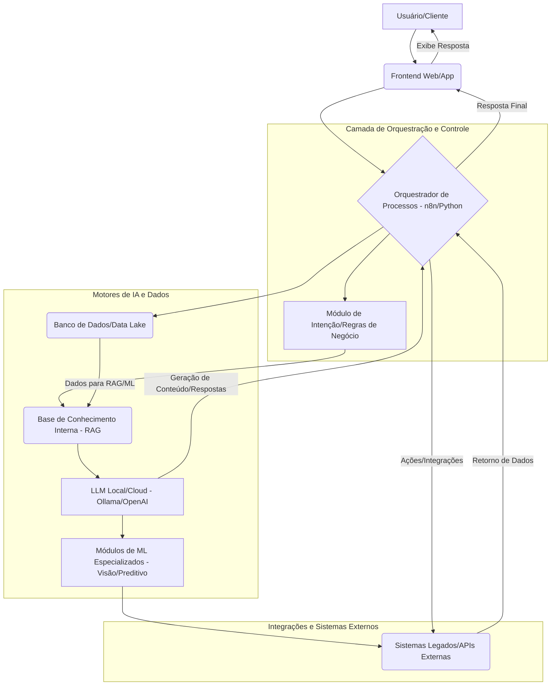

Vamos ser francos, colega. A cada nova "virada de chave" no mundo da Inteligência Artificial, somos bombardeados por manchetes que prometem a AGI (Inteligência Artificial Geral) para amanhã. "A IA agora pensa!", "A IA tem consciência!", "Seu emprego acabou!" — já ouviu isso, não é? A verdade, nua e crua, é que enquanto um LLM devora terabytes de texto e código, ele ainda não sabe que a bola que você soltou vai cair, porque não tem um corpo, não interage com o mundo físico e, francamente, não tem bom senso.

O custo para treinar esses modelos gigantescos continua caindo drasticamente, como apontado por pesquisadores do BAIR, mas o custo de *aplicar* essa "inteligência" de forma útil e segura para resolver problemas reais de negócio é outra história. Estamos falando de bilhões de parâmetros, petabytes de dados e uma complexidade computacional que faz a maioria das empresas suar frio só de pensar em rodar isso em produção.

Minha opinião, baseada em anos de chão de fábrica com infraestrutura e dados, é que estamos vivendo uma bolha de expectativas infladas. A AGI, no sentido de uma inteligência humana generalizada, ainda é um horizonte distante, talvez até inatingível com as arquiteturas atuais. E o pior: essa busca incessante pela AGI está desviando o foco do que realmente importa para as empresas: a aplicação *prática* e *rentável* da IA HOJE.

### A Realidade Brutal da IA em Produção

O que eu vejo no mercado é uma corrida por soluções prontas que prometem mundos e fundos, mas entregam silos de dados, custos exorbitantes e uma dependência perigosa de fornecedores externos. Muitas empresas estão esperando a "IA mágica" que vai resolver tudo, enquanto problemas reais e urgentes continuam sem solução.

Isso é um erro crasso. A IA não é uma bala de prata. É um conjunto de ferramentas poderosas que, quando usadas corretamente, podem transformar processos, otimizar recursos e gerar insights valiosos. Mas a chave está em usá-las *corretamente*, e não em esperar por um milagre tecnológico que simplesmente não vai acontecer no curto ou médio prazo.

### Por Que a AGI é um Distrator para Sua Empresa

Primeiro, o custo. Rodar e manter modelos gigantescos é proibitivo para a maioria das empresas. Segundo, a segurança de dados. Colocar toda a sua inteligência de negócio em modelos de terceiros é um convite a problemas de privacidade e compliance, especialmente com a LGPD no Brasil. Terceiro, a personalização. Modelos genéricos são, por definição, genéricos. Eles não entendem as nuances do seu negócio, da sua cultura ou dos seus clientes como você entende.

A ideia de que um único modelo "inteligente" vai se adaptar a qualquer tarefa e contexto é sedutora, mas irreal. Na prática, a inteligência é fragmentada, especializada. Um médico é um expert em medicina, não em engenharia de foguetes. Por que esperaríamos que uma IA fosse diferente?

### O Caminho Viável: Arquiteturas Híbridas

É aqui que as arquiteturas híbridas entram em cena, e é onde sua empresa deveria estar investindo. Esqueça a AGI por um momento e foque em construir sistemas que combinam o melhor de vários mundos:

*   **Modelos de Linguagem (LLMs):** Para tarefas de geração de texto, sumarização, tradução e interfaces conversacionais.
*   **Sistemas Rule-Based:** Para garantir conformidade, aplicar lógica de negócio inegociável e automatizar fluxos previsíveis.
*   **Modelos de Machine Learning Especializados:** Para visão computacional, análise preditiva, detecção de anomalias, etc.
*   **Bases de Conhecimento RAG (Retrieval Augmented Generation):** A cereja do bolo para a inteligência empresarial.

### RAG: O Segredo para uma IA Contextual e Segura

O RAG não é hype, é solução. Ele permite que seus LLMs consultem *sua* base de dados interna, documentos, manuais, histórico de clientes — qualquer fonte de informação proprietária e atualizada. Isso significa que o LLM não "alucina" com informações erradas ou desatualizadas, mas sim responde com base em dados *reais e verificados* da sua empresa.

Na minha experiência, implementar RAG é um divisor de águas. Já vi equipes de atendimento ao cliente reduzirem o tempo de resposta em 40% e a taxa de erro em 25% simplesmente por dar aos LLMs acesso contextualizado à base de conhecimento da empresa. É o equivalente a dar ao seu time júnior o conhecimento tácito dos seus especialistas mais experientes, instantaneamente.

### O Poder da Automação e da Infraestrutura Flexível

Para que uma arquitetura híbrida funcione, você precisa de uma espinha dorsal robusta. E isso, meu caro, é meu território.

*   **Automação com n8n/Python:** Ferramentas como n8n (ou Node-RED, se preferir) são fantásticas para orquestrar fluxos de trabalho complexos, conectando LLMs, APIs, bases de dados e sistemas legados. O Python, claro, é a linguagem universal para a engenharia de dados e ML.
*   **IA Local (Ollama):** A capacidade de rodar LLMs menores e mais eficientes em servidores on-premise ou em máquinas mais modestas é um *game changer*. Com Ollama, você ganha controle total sobre seus dados, conformidade com a LGPD e custos previsíveis, sem abrir mão do poder dos modelos de linguagem. Isso é crucial para dados sensíveis.
*   **Infraestrutura Linux:** A base de tudo. Servidores Linux bem configurados, contêineres (Docker, Kubernetes) e automação de infraestrutura (Ansible, Terraform) são o alicerce para escalar sua IA de forma eficiente e segura.

### Não Espere pela AGI Mágica, Crie Valor Agora

Empresas que esperam pela AGI para começar a inovar estão perdendo tempo e dinheiro. O valor real está na aplicação pragmática da IA para resolver problemas de negócio específicos e bem definidos.

| Característica         | Abordagem AGI-centric (Hype)                                  | Abordagem Híbrida (Realidade)                                    |
| :--------------------- | :------------------------------------------------------------ | :--------------------------------------------------------------- |
| **Foco Principal**     | Inteligência genérica, capacidade de auto-aprendizado universal | Solução de problemas específicos, integração de sistemas          |
| **Custo Inicial**      | Alto (pesquisa, infraestrutura de ponta, licenciamento)      | Moderado (adaptação de tecnologias existentes, open source)      |
| **Tempo para Valor**   | Longo (anos de P&D, incerteza)                                | Curto a Médio (meses para MVPs, iterações rápidas)               |
| **Controle de Dados**  | Baixo (dependência de provedores de nuvem e modelos externos) | Alto (possibilidade de IA local, RAG com dados internos)         |
| **Conformidade (LGPD)**| Desafiadora (risco de vazamento, governança complexa)       | Gerenciável (controle sobre o fluxo de dados e modelos)          |
| **Flexibilidade**      | Baixa (soluções monolíticas, "black box")                    | Alta (modular, combinável, adaptável às necessidades do negócio) |
| **Complexidade**       | Extremamente alta (pesquisa de ponta, engenharia complexa)   | Gerenciável (integração de componentes conhecidos)               |

A AT&T, por exemplo, está usando a IA para otimizar o trabalho jurídico interno, tornando o conhecimento mais acessível. Eles não estão esperando uma AGI que escreva leis, mas sim usando IA para *amplificar* a capacidade de seus advogados. Isso é inteligência aplicada, não ficção científica.

Os pesquisadores do BAIR estão sempre publicando avanços incríveis, como em "Teaching LLMs to Update Beliefs", que mostra o esforço para fazer LLMs lidarem melhor com interações de longo prazo. Mas perceba: são *avanços*, não a solução final. E esses avanços são complexos e focados em problemas muito específicos. Sua empresa não pode esperar por cada um desses avanços para começar a colher os frutos da IA.

### O Futuro é Modular e Controlado

O futuro da IA nas empresas não é uma AGI onisciente e onipotente. É uma orquestra bem afinada de modelos especializados, automação inteligente e infraestrutura robusta, tudo sob o seu controle. É sobre usar a IA como uma ferramenta para potencializar suas equipes e seus processos, não para substituí-los por uma entidade mágica.

Foque no que é real, no que é aplicável e no que traz retorno sobre investimento hoje. Abandone o hype da AGI e invista em uma arquitetura híbrida que te dê controle, segurança e resultados. É o caminho mais inteligente, pragmático e, na minha opinião, o único caminho sustentável.

## 📚 Referências e Leituras Complementares

*   BAIR Blog. (2026). *Intelligence is Free, Now What? Data Systems for, of, and by Agents*. [Acessado em 20 de outubro de 2026](http://bair.berkeley.edu/blog/2026/07/07/intelligence-is-free-now-what/)
*   BAIR Blog. (2026). *Teaching LLMs to Update Beliefs for Efficient Long-Horizon Interaction*. [Acessado em 20 de outubro de 2026](http://bair.berkeley.edu/blog/2026/07/26/abbel/)
*   OpenAI. (2026). *How AT&T is rethinking in-house legal work with OpenAI*. [Acessado em 20 de outubro de 2026](https://openai.com/index/att-legal)
*   arXiv:2610.28698. (2026). *Scaling in Games: Continued Pre-Training For Embodied Agents In Diverse Virtual Worlds*. [Acessado em 20 de outubro de 2026](https://arxiv.org/abs/2610.28698)
*   arXiv:2610.28706. (2026). *SpecEvo: Speculative Evolution with Large Language Models for Cost-Efficient Scientific Discovery*. [Acessado em 20 de outubro de 2026](https://arxiv.org/abs/2610.28706)

*Artigo desenvolvido por Marcos Vasconcellos de Andrade — Especialista em Infraestrutura Linux, Automação & Engenharia de Dados.*
