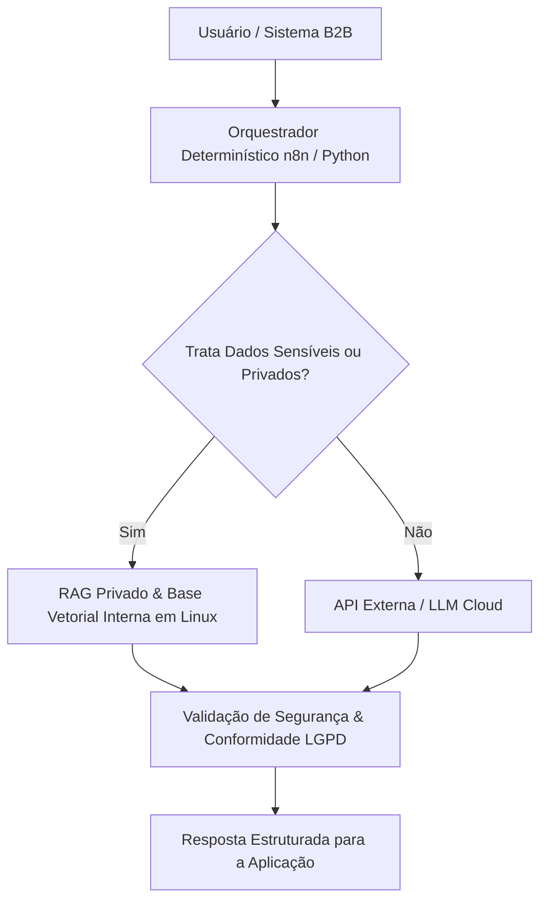

<small><em>Imagem de capa: Infraestrutura de datacenter e servidores Linux de alto desempenho. (Créditos da imagem: Unsplash / Licença CC BY-SA)</em></small>

<blockquote>
"O que é inteligência? Não se trata tanto da capacidade de fazer cálculos, mas sim da habilidade de aprender, adaptar-se e entender a realidade do mundo." - François Chollet
</blockquote>

Vivemos um momento peculiar na história da tecnologia. De um lado, uma narrativa quase messiânica sobre a iminente chegada da **AGI — Inteligência Artificial Geral** — prometendo máquinas que pensarão, planejarão e agirão como humanos (ou melhor que eles). Do outro, uma realidade operacional bem menos glamourosa: empresas que investiram fortunas em provas de conceito baseadas exclusivamente em LLMs e descobriram, muitas vezes da pior forma possível, que alucinações, custos de inferência imprevisíveis e vazamentos de dados sensíveis não são detalhes de implementação — são falhas estruturais.

Este artigo não é um manifesto contra a IA. Pelo contrário: é um defesa apaixonada da IA **bem engenhada**. Minha tese é direta: o hype em torno da AGI, alimentado por uma leitura equivocada do que os LLMs realmente fazem, está atrasando a adoção corporativa de soluções que **funcionam hoje** — arquiteturas híbridas que combinam a flexibilidade dos modelos de linguagem com a previsibilidade da engenharia de software clássica e a soberania de uma infraestrutura Linux bem administrada.

## A Miragem da AGI e a Realidade dos LLMs Autorregressivos

Para entender por que a promessa da AGI baseada em LLMs é, no mínimo, prematura, precisamos descer até o nível matemático do que esses modelos fazem. Na sua essência, um LLM autorregressivo é uma máquina de estimar uma distribuição de probabilidade condicional sobre o **próximo token**:

$$P(x_t \mid x_{<t})$$

Ou seja, dado o histórico de tokens $$x_{<t} = (x_1, x_2, \ldots, x_{t-1})$$, o modelo calcula a probabilidade de cada token candidato $$x_t$$ e amostra (ou seleciona gulosa mente) o próximo. A geração de um texto completo é a composição iterativa dessa operação:

$$P(x_{1:T}) = \prod_{t=1}^{T} P(x_t \mid x_{<t})$$

Esse detalhe aparentemente técnico carrega consequências filosóficas e práticas profundas. O modelo **não modela o mundo**; ele modela a _distribuição estatística de sequências de tokens_ presentes no seu corpus de treinamento. Quando um LLM responde corretamente a uma pergunta de física, ele não está "entendendo" as leis de Newton — está reproduzindo a estrutura estatística de milhões de textos que descrevem essas leis de forma consistente.

Aqui reside a distinção crucial entre **correlação estatística** e **raciocínio causal**. Um sistema que raciocina causalmente possui um modelo do mecanismo gerador dos fenômenos: sabe que se $$A$$ causa $$B$$, então intervir em $$A$$ altera $$B$$, mas intervir em $$B$$ não altera $$A$$. Um LLM, por outro lado, captura regularidades co-ocorrentes nos dados. Em domínios densamente representados no treinamento, essa distinção é quase invisível. Em domínios de cauda longa, em cenários adversariais ou em problemas que exigem composicionalidade genuína — combinar conceitos de maneiras nunca vistas — a fraqueza se manifesta em forma de alucinações, contradições internas e falhas de planejamento em múltiplas etapas.

Há ainda o problema da **compreensão pragmática**. Linguagem natural não é apenas sintaxe e semântica; é um sistema de intenção, contexto compartilhado e pressupostos culturais. A estatística de próxima palavra pode _imitar_ pragmática com impressionante fidelidade, mas imitação não é grounding. O modelo não tem um corpo, não tem objetivos próprios, não sofre consequências de seus erros no mundo físico. Ele opera no espaço dos símbolos, não no espaço da realidade.

Somem-se a isso a **não-determinística intrínseca** da amostragem (mesmo com temperatura zero, variações de batching e versões de modelo podem alterar saídas) e a impossibilidade de garantias formais de correção, e temos o retrato completo: LLMs são ferramentas estatísticas extraordinárias para tarefas de _percepção e geração de linguagem_, mas péssimos candidatos a serem o **cérebro determinístico** de um processo de negócio crítico.

E, no entanto, o mercado insiste em vendê-los como AGI em potência. Essa desconexão entre narrativa e engenharia é o que precisa ser corrigido.

## O Plateau do ARC-AGI e a Promessa dos World Models

Se a discussão anterior parece abstrata, os dados empíricos a tornam concreta. Em 2019, François Chollet — criador do Keras e uma das vozes mais rigorosas do campo — publicou o paper _"On the Measure of Intelligence"_, no qual propôs uma definição operacional de inteligência como **eficiência de aquisição de habilidades** diante de tarefas novas, e não como performance em domínios já vistos no treinamento. Dessa formulação nasceu o **ARC-AGI** (Abstraction and Reasoning Corpus): puzzles visuais que um humano resolve com poucos exemplos, mas que exigem indução de regras abstratas completamente novas a cada instância.

Por anos, os melhores sistemas de IA pontuaram pouco acima do acaso no ARC-AGI, enquanto humanos medianos atingiam taxas altíssimas de acerto. O padrão era revelador: **scaling laws puras** — mais dados, mais parâmetros, mais compute — não resolviam o problema. Modelos com centenas de bilhões de parâmetros, treinados com trilhões de tokens, continuavam falhando em tarefas que uma criança de dez anos executa sem esforço. Isso sugere fortemente que a escalabilidade estatística captura uma _parte_ da cognição (a parte de reconhecimento de padrões e recuperação interpolativa), mas não a parte de **abstração e raciocínio sistemático** que Chollet identifica como núcleo da inteligência geral.

Vale registrar que avanços recentes com raciocínio em cadeia e busca combinatória melhoraram pontuações no benchmark — mas o fazem via _engenharia de inferência_ (gastar ordens de magnitude mais compute por problema), o que na verdade **reforça** a tese de Chollet: a eficiência de aquisição continua baixa; estamos comprando performance com bruta força computacional, não com inteligência genuína.

Diante desse plateau, a alternativa mais promissora vem de Yann LeCun, ganhador do Prêmio Turing e arquiteto-chefe de IA da Meta. Em seu paper _"A Path Towards Autonomous Machine Intelligence"_ (2022), LeCun argumenta que a arquitetura autorregressiva em espaço de tokens é um beco sem saída para agentes autônomos. Sua proposta central são os **World Models** — arquiteturas que aprendem representações preditivas do mundo e operam planejando _no espaço latente_, não no espaço de símbolos.

A materialização mais concreta dessa visão é a família de arquiteturas **JECA — Joint Embedding Predictive Architecture (JEPA)**. A ideia é elegante: em vez de prever _pixels_ ou _tokens_ brutos (o que força o modelo a gastar capacidade modelando detalhes irrelevantes), o JEPA prevê **representações abstratas** do futuro dado o presente. O objetivo de treinamento minimiza a distância entre a representação prevista do alvo e a representação real do alvo, ambos codificados no espaço latente:

$$\min_{\theta} \; \mathcal{L}\big(g_{\theta}(s), \; \text{sg}[\bar{g}_{\theta}(s')]\big)$$

onde $$g_{\theta}$$ é o codificador online, $$\bar{g}_{\theta}$$ o codificador alvo (com parâmetros atualizados lentamente, via _stop-gradient_ — daí o `sg`), $$s$$ o contexto observado e $$s'$$ o alvo futuro. Esse esquema evita o colapso representacional e força o sistema a aprender **invariâncias estruturais** do mundo — exatamente o tipo de conhecimento causal e físico que os LLMs não possuem.

Para o contexto corporativo, a lição é clara: a próxima onda de valor não virá de um LLM maior, mas de sistemas que combinam percepção estatística com modelos do mundo e planejamento. E enquanto essa arquitetura amadurece, empresas inteligentes não ficam esperando — elas constroem hoje arquiteturas que extraem o máximo dos LLMs atuais **sem apostar o negócio neles**.

## Arquiteturas Híbridas B2B: O Caminho Pragmático para Inovação

É aqui que a engenharia encontra o pragmatismo. Uma **arquitetura híbrida B2B** reconhece a divisão natural de trabalho entre o que LLMs fazem bem e o que sistemas determinísticos fazem bem:

**1. LLMs para extração de intenção e linguagem natural.** O LLM é excelente no que foi treinado para fazer: interpretar linguagem humana ambígua, estruturar requisições não estruturadas, classificar intenções, resumir e traduzir. Em uma arquitetura híbrida, o LLM atua como uma _camada de tradução_ entre o mundo humano e o mundo das máquinas — nunca como o executor final da lógica de negócio. Ele converte "preciso renegociar o contrato do fornecedor X porque o prazo venceu" em um JSON estruturado com entidade, ação e prioridade. A partir daí, o LLM sai de cena.

**2. Orquestração determinística com n8n, Python e Go.** A lógica de negócio — validações, regras, fluxos de aprovação, integrações com ERPs e CRMs — roda em código determinístico, testável e auditável. O **n8n** brilha como camada visual de orquestração de workflows, permitindo que times de negócio entendam e auditem fluxos. **Python** domina o pipeline de dados: ETL, enriquecimento, chamadas a modelos, pós-processamento com validação de esquemas (Pydantic é seu amigo). **Go** entra onde performance e concorrência importam: serviços de alta vazão, workers de fila, APIs de baixa latência. Cada componente tem contrato claro, testes automatizados e comportamento previsível. Se o LLM alucina na extração de intenção, a camada determinística **rejeita** a saída malformada em vez de executá-la cegamente.

**3. RAG Privado em servidores Linux.** Retrieval-Augmented Generation bem implementado resolve o problema do conhecimento proprietário sem expor dados. A arquitetura que defendo roda **on-premise ou em nuvem privada**: modelos open-weights (Llama, Mistral, Qwen) servidos via vLLM ou Ollama em servidores Linux devidamente dimensionados, base vetorial própria (Qdrant, pgvector, Milvus), tudo sob controle total do perímetro da empresa. O Linux não é detalhe aqui — é fundação. Hardening de kernel, namespaces e cgroups para isolamento de workloads de inferência, criptografia em repouso e em trânsito, auditoria via journald e auditd, backups testados. Quem administra infraestrutura Linux séria sabe: soberania de dados não é slogan, é disciplina operacional.

**4. Conformidade LGPD por design.** A Lei Geral de Proteção de Dados transforma arquitetura em questão jurídica. Enviar dados de clientes brasileiros para APIs de terceiros em jurisdições estrangeiras exige base legal cuidadosa, avaliação de transferência internacional e cláusulas contratuais — e mesmo assim cria superfície de risco. Na arquitetura híbrida, o roteador de dados decide **antes** do processamento: dados sensíveis e privados ficam no perímetro interno, processados por modelos locais; apenas dados não sensíveis e anonimizados podem, opcionalmente, trafegar para serviços externos. A LGPD deixa de ser um checklist de conformidade e vira uma propriedade emergente da arquitetura.

<figure class="my-4">
  
  <figcaption class="text-center text-muted mt-2"><small>Fluxo de orquestração híbrida conectando RAG Privado e LLMs locais com total controle de dados. <em>(Imagem: Unsplash / Licença CC BY-SA)</em></small></figcaption>
</figure>

## Diagrama da Arquitetura Híbrida B2B

Observe o ponto crítico do diagrama: o nó de decisão `C` e o nó de validação `F`. Eles materializam o princípio central desta arquitetura — **o LLM nunca é o ponto único de falha nem o único guardião dos dados**. A decisão de roteamento é determinística; a validação final é determinística; a IA é um componente poderoso dentro de um sistema de engenharia, não um oráculo substituindo a engenharia.

## Comparativo: LLM Monolítico vs. Arquitetura Híbrida B2B

| Critério               | LLM Monolítico (Hype AGI)                     | Arquitetura Híbrida B2B (Prática)            |
| :--------------------- | :-------------------------------------------- | :------------------------------------------- |
| **Soberania de Dados** | Risco de exposição em APIs de terceiros       | Total controle on-premise / nuvem privada    |
| **Previsibilidade**    | Propenso a alucinações não-determinísticas    | Lógica de negócios 100% determinística       |
| **Custo de Operação**  | Escalabilidade cara por token em nuvem        | Custos otimizados com infraestrutura própria |
| **Conformidade LGPD**  | Complexo devido ao tráfego de dados sensíveis | LGPD por design no perímetro da empresa      |

Uma observação honesta sobre trade-offs: arquiteturas híbridas exigem mais investimento inicial em engenharia e infraestrutura. Você precisará de gente que administra Kubernetes ou serviços systemd, que dimensiona GPUs ou otimiza quantização de modelos, que constrói pipelines de ingestão e indexação vetorial. Mas esse custo é **capex previsível e ativo próprio** — em contraste com o opex imprevisível de tokens em nuvem, que escala com o sucesso do produto e corrói margens justamente quando o negócio cresce. E, crucialmente, a arquitetura híbrida é **future-proof**: quando os World Models e arquiteturas JEPA amadurecerem, você troca o componente de percepção — o orquestrador, o RAG e a camada determinística permanecem.

## Conclusão: O Valor Real da Engenharia de Dados

O fim do hype da AGI não será um evento dramático. Será um desvanecimento gradual: os roadmaps prometidos não se materializarão nos prazos anunciados, os benchmarks revelarão plateaus, e o mercado redescobrirá uma verdade antiga da engenharia — **sistemas confiáveis vencem sistemas impressionantes**.

Nesse cenário, o valor migrará para quem domina o que sempre sustentou sistemas confiáveis: **engenharia de dados, automação e infraestrutura**. Pipelines de dados bem governados, porque RAG sem qualidade de dados é lixo estatisticamente embalado. Automação determinística, porque lógica de negócio em prompt é dívida técnica disfarçada de inovação. Infraestrutura Linux sólida, porque soberania de dados, latência e custo são decididos na camada de infraestrutura, não no playground do fornecedor de API.

A lição final é paradoxalmente simples: quanto mais poderosa a IA se torna, mais importante se torna a engenharia ao redor dela. LLMs são motores extraordinários — mas motor nenhum vence uma corrida sem chassi, transmissão e piloto. As empresas que entenderão isso cedo construirão hoje arquiteturas híbridas que entregam valor mensurável, respeitam a LGPD e sobrevivem à próxima mudança de paradigma. As que apostarem tudo na miragem da AGI descobrirão que, em tecnologia, hype é o único componente que nunca entrega o prometido.

_Revisado e adaptado por Marcos Vasconcellos de Andrade — Arquitetura de Dados & IA._

## 📚 Referências e Leituras Complementares

- [Chollet, F. (2019). The Measure of Intelligence](https://arxiv.org/abs/1911.01547)
- [LeCun, Y. (2022). A Path Towards Autonomous Machine Intelligence](https://openreview.net/forum?id=BZ5a1r-fZa)
- [BAIR Blog. Data Systems for, of, and by Agents](https://bair.berkeley.edu/)
- [OpenAI. Scaling Storage and Infrastructure for Enterprise LLMs](https://openai.com/index/)
