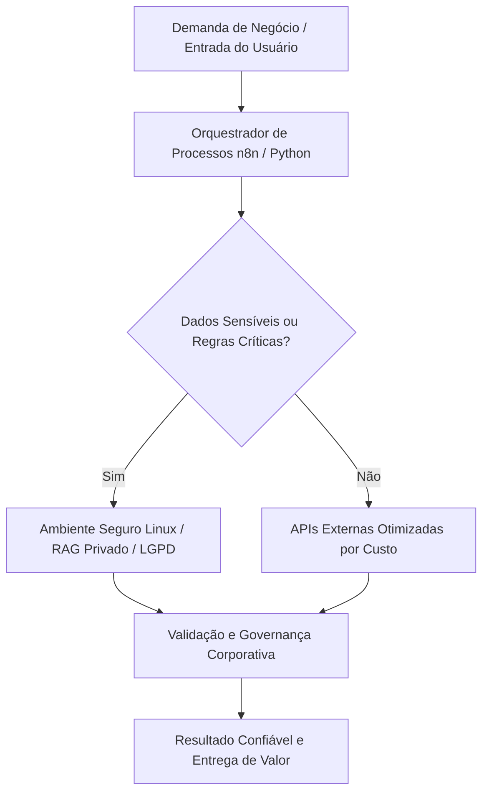

<small><em>Imagem de capa: O Fim do Hype da AGI: Por Que Sua Empresa Deveria Focar em Arquiteturas Híbridas. (Créditos: <a href="/assets/img/posts/o-fim-do-hype-da-agi-por-que-sua-empresa-deveria-focar-em/cover.jpg" target="_blank" rel="noopener">Unsplash</a>)</em></small>

<blockquote>
"Não há nada tão inútil quanto fazer com grande eficiência algo que não deveria ser feito de forma alguma." - Peter Drucker
</blockquote>

## O Contexto de Mercado e a Dor Real das Empresas

Em um mundo corporativo cada vez mais saturado pelo buzz da Inteligência Artificial, é fácil para líderes e tomadores de decisão se perderem na promessa de uma "Inteligência Artificial Geral" (AGI). Manchetes e conferências pintam um futuro onde a IA resolve tudo, desde a estratégia de negócios até o atendimento ao cliente, com uma autonomia quase humana. Essa narrativa, embora fascinante, tem levado muitas empresas a um caminho perigoso: o investimento em soluções complexas, caras e, muitas vezes, inviáveis no curto e médio prazo, que não entregam valor real e imediato.

A dor é palpável: vejo empresas gastando milhões em projetos ambiciosos que prometem a AGI para daqui a 5 ou 10 anos, enquanto problemas urgentes de segurança de dados, conformidade com a LGPD, otimização de custos operacionais e automação de processos críticos permanecem sem solução. O foco no "nirvana" da AGI desvia recursos e atenção de oportunidades tangíveis que a IA atual já pode oferecer.

O resultado? Frustração, orçamentos estourados e, o mais grave, a exposição a riscos de segurança e governança de dados. Soluções genéricas e "mágicas" frequentemente implicam em enviar dados sensíveis para plataformas públicas sem controle, comprometendo a soberania da informação e a conformidade regulatória. A escalabilidade se torna um pesadelo, e o ROI, uma miragem.

Minha experiência prática, trabalhando na linha de frente da infraestrutura e automação, mostra que o valor real da IA para sua empresa não está em perseguir uma IA que pensa como humanos, mas em aplicar inteligência de forma estratégica para resolver problemas *específicos* e *urgentes*. O foco deve ser em arquiteturas pragmáticas que combinem o melhor de dois mundos, garantindo segurança, custo-benefício e resultados mensuráveis.

## Desmistificando a Tecnologia: O Que Realmente Funciona

Vamos ser claros: a AGI, a capacidade de uma máquina realizar qualquer tarefa intelectual que um ser humano pode, ainda é um conceito teórico e distante. Embora haja avanços notáveis em áreas como geração de texto e imagem, e até mesmo em simulações de mundo mais realistas como o *Genie 4* da DeepMind, ou a capacidade de modelos como o *GPT-6 Astra* de otimizar processos jurídicos (como visto na Legora) ou acelerar pesquisas de vulnerabilidade (Check Point Daybreak), essas são, em essência, aplicações de IA *especializada*.

Pense na diferença entre um canivete suíço e um conjunto de ferramentas profissionais. O canivete suíço é versátil, mas limitado em cada função. As ferramentas profissionais, por outro lado, são altamente eficientes para suas tarefas específicas. A IA atual é esse conjunto de ferramentas especializadas. Ela é extraordinariamente poderosa em domínios específicos: analisar contratos, detectar fraudes (como a colaboração da DeepMind com o governo de Singapura para detecção de golpes), otimizar cadeias de suprimentos, ou auxiliar na pesquisa científica.

O que realmente funciona hoje são os modelos de IA "estreitos" ou "especializados". Eles são treinados para tarefas bem definidas e, quando bem implementados, entregam resultados transformadores. O desafio reside em como integrar esses modelos de forma segura, eficiente e econômica na infraestrutura existente da sua empresa.

É aqui que as **arquiteturas híbridas de IA** se destacam. Elas representam a abordagem mais inteligente e pragmática, permitindo que sua empresa aproveite o poder da IA sem comprometer a segurança, a governança e o controle de custos. Em vez de uma solução "tudo ou nada", a arquitetura híbrida permite que você escolha a melhor ferramenta para cada trabalho, mantendo seus dados mais valiosos sob seu controle.

## O Caminho Pragmático: Arquitetura e Engenharia de Valor

A essência de uma arquitetura híbrida de IA reside em uma estratégia inteligente de **orquestração de dados e modelos**. Imagine um centro de comando onde você decide qual informação pode ir para o "mundo externo" (APIs de IA públicas) e qual deve permanecer estritamente dentro do seu perímetro corporativo (modelos especializados on-premise ou em nuvem privada).

Essa orquestração é a chave para a segurança e o custo-benefício. Para dados sensíveis, informações proprietárias ou processos que exigem conformidade rigorosa com a LGPD, a solução é clara: modelos de IA especializados rodando em **ambientes seguros Linux**, seja em servidores próprios ou em uma nuvem privada. Aqui, o **RAG (Retrieval-Augmented Generation) Privado** se torna um pilar fundamental. Em vez de enviar seus documentos internos e bases de conhecimento para um LLM público, você constrói um sistema RAG que consulta seus próprios dados, mantendo-os sempre dentro do seu controle. Isso garante que a inteligência gerada seja baseada em informações corporativas fidedignas e seguras.

<figure class="my-4">
  
  <figcaption class="text-center text-muted mt-2"><small>Fluxo prático de engenharia e dados conectando sistemas corporativos de forma segura. <em>(Fonte: <a href="/assets/img/posts/o-fim-do-hype-da-agi-por-que-sua-empresa-deveria-focar-em/figura1.jpg" target="_blank" rel="noopener">Unsplash</a>)</em></small></figcaption>
</figure>

Para tarefas mais genéricas, que não envolvem dados sensíveis ou que se beneficiam da escalabilidade e do poder de modelos de ponta, as **APIs externas de IA** são uma excelente opção. Pense em sumarização de notícias públicas, geração de ideias de marketing baseadas em tendências de mercado ou tradução de idiomas. A integração com essas APIs é feita de forma otimizada para custo, utilizando-as apenas quando necessário e com controle estrito sobre o que é enviado.

A **orquestração de processos** é o cérebro dessa arquitetura. Ferramentas como n8n, ou scripts Python customizados, atuam como maestros, direcionando cada requisição para o modelo e ambiente apropriado. Isso não apenas garante a segurança, mas também otimiza os custos, pois você não paga por serviços de IA pública para tarefas que podem ser resolvidas internamente ou que exigem maior controle.

A infraestrutura Linux, robusta e flexível, é o alicerce dessa estratégia, proporcionando a base para a automação de processos, a segurança dos dados e a escalabilidade necessária para as demandas corporativas. A **governança de dados** é integrada desde a concepção, com trilhas de auditoria, controle de acesso e políticas de retenção que garantem a conformidade regulatória e a confiança nos resultados.

Este é o verdadeiro caminho para a engenharia de valor com IA: focar em soluções que resolvam problemas reais, com controle, segurança e um ROI claro e sustentável.

## Diagrama da Solução B2B

## Comparativo Estratégico: Soluções Genéricas vs. Engenharia Pragmática

Para ilustrar a diferença entre a busca pelo hype e a aplicação de engenharia de valor, observe este comparativo:

| Dimensão de Negócio | Abordagem Genérica / Hype | Engenharia Pragmática B2B |
| :--- | :--- | :--- |
| **Soberania e Segurança** | Risco de vazamento em ferramentas públicas | Controle total dos dados no perímetro corporativo |
| **Previsibilidade Operacional** | Respostas instáveis e custos imprevisíveis | Lógica determinística e regras de negócio auditáveis |
| **Custo de Operação** | Faturas crescentes e imprevisíveis por uso | Infraestrutura otimizada em servidores Linux próprios |
| **Conformidade Regulatória** | Dificuldade de atendimento à LGPD | LGPD e governança integradas desde a concepção |
| **Foco Estratégico** | Busca por "IA mágica" e soluções genéricas | Resolução de problemas de negócio específicos e urgentes |
| **ROI (Retorno sobre Investimento)** | Difícil de mensurar, longo prazo e incerto | Mensurável, de curto a médio prazo, com valor tangível |

## Conclusão e Próximos Passos para Líderes

O hype da AGI é uma distração custosa e arriscada. Para líderes e diretores que buscam resultados reais, a estratégia é clara: abandone a busca por uma inteligência artificial que ainda não existe e concentre-se em construir **arquiteturas híbridas de IA robustas e pragmáticas**.

Sua empresa pode e deve gerar valor imediato com a IA. Isso significa:

1.  **Priorizar a Governança e Segurança de Dados:** Implemente soluções que mantenham seus dados sensíveis dentro do seu controle, garantindo conformidade com a LGPD e evitando riscos de vazamento.
2.  **Investir em Infraestrutura Sólida:** Uma base em infraestrutura Linux proporciona a flexibilidade, segurança e escalabilidade necessárias para hospedar modelos especializados e orquestrar processos.
3.  **Focar na Automação de Processos com IA:** Identifique os gargalos operacionais e aplique IA especializada para otimizar, automatizar e acelerar tarefas repetitivas, liberando sua equipe para atividades de maior valor.
4.  **Adotar uma Abordagem Híbrida:** Combine a força de modelos internos (RAG privado) para dados críticos com a agilidade de APIs públicas para tarefas genéricas, sempre com uma camada inteligente de orquestração.

Ao adotar essa postura, sua empresa não apenas otimizará custos e mitigará riscos, mas também construirá uma base sólida para a inovação contínua. Não se trata de esperar pelo futuro, mas de construir um presente inteligente, seguro e lucrativo.

*Artigo elaborado por Marcos Vasconcellos de Andrade — Especialista em Infraestrutura Linux, Automação de Processos e Engenharia de Dados.*

## 📚 Referências e Leituras Recomendadas
- [Estudos de caso e melhores práticas em IA Corporativa](https://bair.berkeley.edu/)
- [Artigos e documentação técnica de infraestrutura](https://arxiv.org/)
- [Guia de conformidade de dados e governança](https://www.gov.br/anpd/)
- [Exemplos de aplicações práticas de IA em empresas (OpenAI)](https://openai.com/customers)
- [Inovações em modelos de IA e simulações (Google DeepMind)](https://deepmind.google/blog/)
