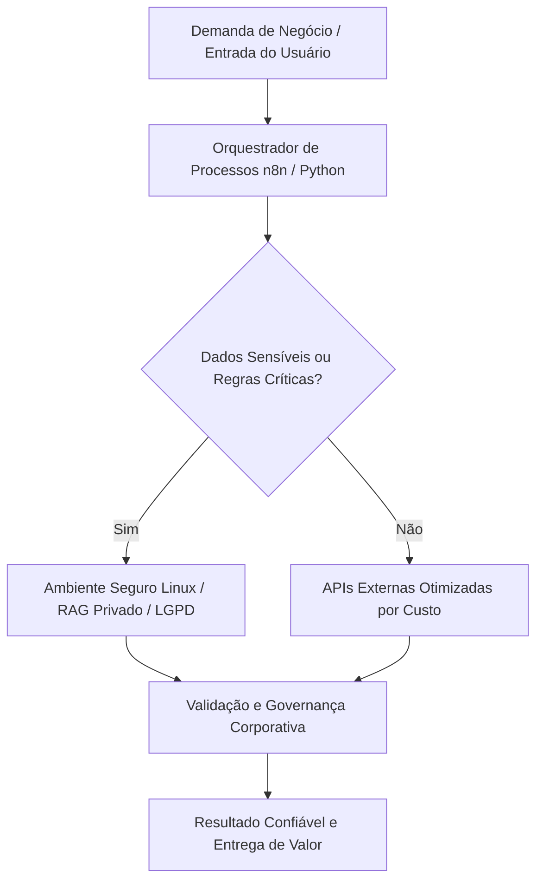

<small><em>Imagem de capa: O Fim do Hype da AGI: Por Que Sua Empresa Deveria Focar em Arquiteturas Híbridas. (Créditos: <a href="{{ '/assets/img/posts/o-fim-do-hype-da-agi-por-que-sua-empresa-deveria-focar-em/cover.jpg' | relative_url }}" target="_blank" rel="noopener">Imagem ilustrativa</a>)</em></small>

<blockquote>
"A melhor maneira de prever o futuro é criá-lo." - Peter Drucker
</blockquote>

## O Contexto de Mercado e a Dor Real das Empresas
A "Corrida do Ouro" da Inteligência Artificial Geral (AGI) tem dominado as manchetes e as conversas corporativas, prometendo uma era de automação total e capacidades quase humanas. Contudo, como especialista em infraestrutura Linux, automação e engenharia de dados, Marcos Vasconcellos de Andrade observa com preocupação a proliferação de um "hype" que, embora excitante, desvia as empresas de um foco pragmático e rentável.

A dor real que as organizações enfrentam hoje não é a falta de superinteligência, mas a incapacidade de transformar promessas abstratas em valor de negócio tangível. Investimentos maciços em tecnologias de IA imaturas ou inadequadas, impulsionados pela miragem da AGI, frequentemente resultam em:
*   **Alucinações Técnicas:** Sistemas que geram informações incorretas ou inconsistentes, minando a confiança e a tomada de decisão.
*   **Custos Elevados e Inesperados:** Faturas crescentes de APIs externas, infraestrutura sobredimensionada e manutenção complexa, sem um retorno claro sobre o investimento.
*   **Falha na Entrega de Valor:** Projetos que não saem do piloto, incapazes de se integrar aos sistemas legados ou de resolver problemas de negócio de forma escalável e segura.
*   **Riscos de Segurança e LGPD:** A adoção descontrolada de ferramentas de IA públicas pode expor dados sensíveis, violando regulamentações como a LGPD e comprometendo a reputação da empresa.

Enquanto a promessa da AGI permanece distante, o mercado clama por soluções que enderecem desafios concretos: otimização de processos, redução de despesas operacionais, segurança de dados e insights acionáveis. Ignorar essa realidade em busca de uma "solução mágica" é um luxo que poucas empresas podem se dar, transformando o potencial da IA em um dreno de recursos e uma fonte de frustração estratégica. É imperativo que líderes e diretores reorientem seus investimentos para abordagens que ofereçam resultados previsíveis e auditáveis.

## Desmistificando a Tecnologia: O Que Realmente Funciona
A verdadeira força da Inteligência Artificial para o ambiente corporativo reside não na emulação da consciência humana, mas na sua capacidade de resolver problemas específicos e bem definidos. O que temos hoje são modelos de Inteligência Artificial Estreita (ANI – Artificial Narrow Intelligence) – ferramentas poderosas, mas especializadas. Os Large Language Models (LLMs), como GPT-4, são um exemplo primoroso dessa capacidade, destacando-se na compreensão e geração de linguagem natural. No entanto, sua eficácia no contexto B2B é maximizada quando não operam isoladamente.

O desafio está em transcender o uso isolado de LLMs para construir sistemas que se integrem de forma coesa com o ecossistema tecnológico existente da sua empresa. Aqui, o conceito de **arquiteturas híbridas de IA** emerge como a solução pragmática. Isso significa combinar a capacidade generativa dos LLMs com a robustez e determinismo de sistemas legados, bases de dados corporativas e modelos de agentes especializados.

Imagine um escritório de advocacia utilizando agentes de IA para acelerar fluxos de trabalho legais, expandir a análise de contratos e liberar advogados para tarefas de maior valor – um cenário que a Legora, por exemplo, já explora com modelos OpenAI ([Legora is building the agentic operating system for legal work](https://openai.com/index/legora-agentic-operating-system-for-legal-work)). Ou pense em como a Retell utiliza LLMs para aprimorar o atendimento telefônico, processando milhões de chamadas mensais ([Retell uses OpenAI models to help power 100M monthly calls](https://openai.com/index/retell-ai)). Em ambos os casos, o sucesso advém da integração inteligente, não da autonomia total da IA.

Para o gestor, isso significa entender que a IA não é uma caixa preta. É uma ferramenta que precisa ser orquestrada, treinada com dados relevantes da sua empresa e integrada de forma segura. O *Retrieval Augmented Generation (RAG) privado*, por exemplo, é uma técnica essencial. Ele permite que LLMs acessem e complementem suas respostas com informações precisas e atualizadas de sua base de conhecimento interna, garantindo que a IA “alucine” menos e forneça dados factuais, dentro do controle e segurança corporativa. É a combinação de inteligências distintas, supervisionadas por uma engenharia robusta, que de fato gera valor.

## O Caminho Pragmático: Arquitetura e Engenharia de Valor
Para traduzir as promessas da IA em resultados concretos, as empresas devem adotar uma abordagem de engenharia pragmática e orientada a valor. Como especialista, Marcos Vasconcellos de Andrade defende que o foco deve ser na criação de arquiteturas de IA híbridas que garantam controle, segurança e eficiência.

1.  **Orquestração Determinística para Previsibilidade:**
    A imprevisibilidade é o inimigo do negócio. Soluções mágicas de IA frequentemente falham porque carecem de lógica determinística. A chave é orquestrar os processos de IA utilizando ferramentas como n8n, Apache Airflow ou scripts Python robustos. Isso permite definir fluxos de trabalho claros: quando um LLM deve ser invocado, quais dados ele pode acessar, como suas respostas são validadas e como interage com sistemas legados (CRMs, ERPs, bancos de dados internos). Essa camada de orquestração garante que a IA opere dentro das regras de negócio, minimizando "alucinações" e assegurando que cada interação gere um resultado auditável e confiável. É a diferença entre um assistente autônomo e um funcionário bem treinado e supervisionado.

2.  **Infraestrutura Linux Segura e Soberania de Dados:**
    A fundação de qualquer arquitetura de IA B2B deve ser uma infraestrutura robusta e segura, e o Linux é a espinha dorsal ideal para isso. Hospedar modelos de IA, especialmente aqueles que lidam com dados sensíveis, em servidores Linux próprios ou em ambientes de nuvem privados e controlados, oferece soberania de dados. Isso significa que sua empresa mantém total controle sobre onde e como seus dados são processados e armazenados, crucial para a conformidade regulatória. Além disso, a otimização de custos é significativamente maior quando a infraestrutura é dimensionada e gerenciada internamente, evitando os gastos crescentes e imprevisíveis das APIs externas. A Check Point, por exemplo, acelerou sua pesquisa de vulnerabilidades utilizando soluções de IA controladas, demonstrando a importância da segurança e da otimização ([How Check Point accelerates vulnerability research with Daybreak](https://openai.com/index/check-point-daybreak)).

3.  **RAG Privado e Governança Robusta para LGPD:**
    A preocupação com a LGPD e outras regulamentações de privacidade de dados não é um obstáculo, mas um imperativo que molda a arquitetura de IA. O **RAG privado** (Retrieval Augmented Generation) é fundamental aqui. Em vez de permitir que um LLM acesse a internet ou bases de conhecimento genéricas, ele é configurado para interagir exclusivamente com bases de dados internas da empresa – documentos, manuais, históricos de clientes – que estão sob seu controle de acesso e segurança. Essa abordagem não só aumenta a precisão e a relevância das respostas, mas também garante que nenhum dado sensível vaze para fora do perímetro corporativo. A governança de dados deve ser integrada desde a concepção do projeto, com trilhas de auditoria, políticas de acesso e mascaramento de dados, transformando a conformidade em um diferencial competitivo.

Ao focar nessa engenharia prática, sua empresa constrói soluções de IA que são não apenas inovadoras, mas fundamentalmente confiáveis, seguras e com um retorno sobre investimento claro. É um caminho de valor real, longe das armadilhas do hype.

<figure class="my-4">
  
  <figcaption class="text-center text-muted mt-2"><small>Fluxo prático de engenharia e dados conectando sistemas corporativos de forma segura. <em>(Fonte: <a href="{{ '/assets/img/posts/o-fim-do-hype-da-agi-por-que-sua-empresa-deveria-focar-em/figura1.jpg' | relative_url }}" target="_blank" rel="noopener">Imagem ilustrativa</a>)</em></small></figcaption>
</figure>

## Diagrama da Solução B2B

## Comparativo Estratégico: Soluções Genéricas vs. Engenharia Pragmática

| Dimensão de Negócio | Abordagem Genérica / Hype | Engenharia Pragmática B2B |
| :--- | :--- | :--- |
| **Soberania e Segurança** | Risco de vazamento em ferramentas públicas | Controle total dos dados no perímetro corporativo |
| **Previsibilidade Operacional** | Respostas instáveis e custos imprevisíveis | Lógica determinística e regras de negócio auditáveis |
| **Custo de Operação** | Faturas crescentes e imprevisíveis por uso | Infraestrutura otimizada em servidores Linux próprios |
| **Conformidade Regulatória** | Dificuldade de atendimento à LGPD | LGPD e governança integradas desde a concepção |

## Conclusão e Próximos Passos para Líderes
O entusiasmo em torno da AGI é compreensível, mas como demonstramos, o caminho para o valor real da IA nas empresas não passa pela expectativa de uma inteligência generalizada que ainda não existe. Ele reside na implementação estratégica de **arquiteturas de IA híbridas** – a fusão inteligente de Large Language Models com sistemas legados, dados corporativos e agentes especializados, tudo sob uma orquestração rigorosa e uma infraestrutura segura.

Para líderes, diretores e tomadores de decisão, a mensagem é clara:
*   **Abrace o Pragmatismo:** Desvie o foco do "hype" e direcione os recursos para soluções de IA que resolvam problemas de negócio concretos, gerem economia de custos e aumentem a eficiência operacional hoje.
*   **Invista em Arquitetura, Não Apenas em Modelos:** O valor está na engenharia por trás da IA – na orquestração determinística, na segurança da infraestrutura Linux, no controle de dados com RAG privado e na governança robusta que garante a conformidade com a LGPD.
*   **Busque Expertise em Integração:** A complexidade da IA híbrida exige especialistas que não apenas entendam os modelos, mas que saibam como integrá-los de forma segura e eficiente ao seu ambiente corporativo. Profissionais com experiência em infraestrutura Linux, automação de processos e engenharia de dados são indispensáveis para traduzir a teoria em resultados práticos.

A Inteligência Artificial já está transformando o cenário corporativo, mas seu sucesso não será definido por quão "humana" ela se torna, e sim por quão bem ela é arquitetada para servir aos objetivos estratégicos de sua empresa. O futuro é híbrido, seguro e pragmaticamente inteligente.

*Artigo elaborado por Marcos Vasconcellos de Andrade — Especialista em Infraestrutura Linux, Automação de Processos e Engenharia de Dados.*

## 📚 Referências e Leituras Recomendadas
- [Estudos de caso e melhores práticas em IA Corporativa](https://bair.berkeley.edu/)
- [Artigos e documentação técnica de infraestrutura](https://arxiv.org/)
- [Guia de conformidade de dados e governança](https://www.gov.br/anpd/)
