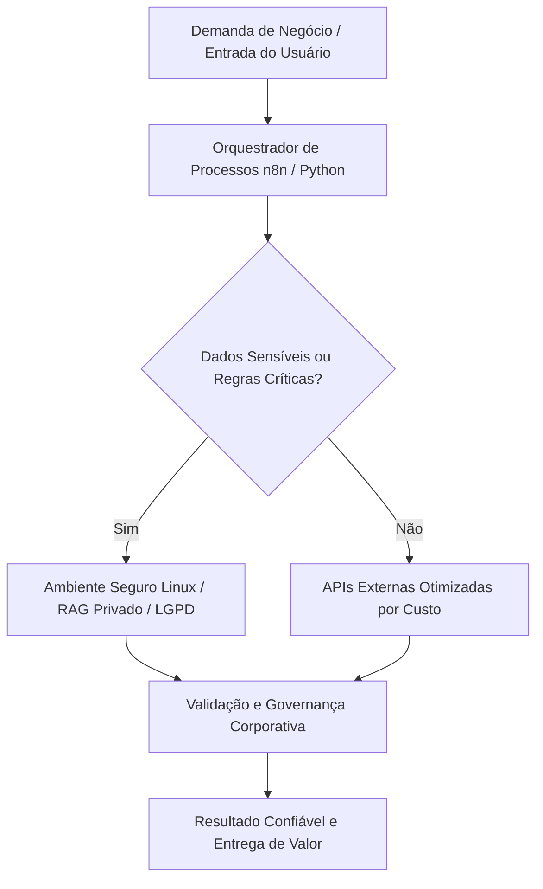

<small><em>Imagem de capa: O Fim do Hype da AGI: Por Que Sua Empresa Deveria Focar em Arquiteturas Híbridas. (Créditos: <a href="{{ '/assets/img/posts/o-fim-do-hype-da-agi-por-que-sua-empresa-deveria-focar-em/cover.jpg' | relative_url }}" target="_blank" rel="noopener">Imagem ilustrativa</a>)</em></small>

<blockquote>
"Não há nada tão inútil quanto fazer com grande eficiência aquilo que não deveria ser feito de forma alguma." - Peter Drucker
</blockquote>

## O Contexto de Mercado e a Dor Real das Empresas

No cenário corporativo atual, a Inteligência Artificial (IA) é, sem dúvida, um dos temas mais debatidos em salas de diretoria. No entanto, em meio a essa efervescência, há um perigo real: a busca incessante por uma "Inteligência Artificial Geral" (AGI) — a ideia de uma IA que possa realizar qualquer tarefa intelectual humana — tem desviado o foco e os recursos de muitas empresas. Essa utopia tecnológica, embora fascinante, muitas vezes resulta em projetos caros, com riscos de segurança e privacidade significativos, e que falham em entregar valor de negócio tangível e escalável no curto e médio prazo.

Como especialista em infraestrutura Linux, automação de processos e engenharia de dados, vejo diariamente a frustração de líderes que investem pesado em soluções "mágicas" de IA, apenas para se depararem com sistemas complexos, imprevisíveis e que não se integram à realidade operacional da empresa. A dor é palpável: orçamentos estourados, dados sensíveis expostos, e a incapacidade de demonstrar um Retorno sobre Investimento (ROI) claro. A promessa da AGI, com sua capacidade onipotente, pode soar tentadora, mas ignora as necessidades pragmáticas de um negócio: otimização de processos, redução de custos, garantia de segurança e conformidade com a LGPD.

O verdadeiro desafio não é construir um cérebro digital universal, mas sim aplicar a IA de forma inteligente e cirúrgica para resolver problemas específicos do seu negócio. A especulação sobre quando a AGI surgirá é um luxo que poucas empresas podem se dar, especialmente quando há oportunidades concretas de transformação digital batendo à porta. É hora de ancorar a estratégia de IA na realidade, focando em soluções que entregam resultados mensuráveis hoje, não em um futuro incerto.

## Desmistificando a Tecnologia: O Que Realmente Funciona

Para desmistificar a IA, precisamos entender que a maior parte do valor gerado atualmente não vem de uma inteligência "geral", mas de modelos especializados e bem treinados para tarefas específicas. Pense em um médico especialista versus um clínico geral. Ambos são essenciais, mas para um problema cardíaco, você procura o cardiologista. No mundo da IA, é a mesma lógica: um modelo treinado para otimizar rotas de entrega fará isso de forma muito mais eficiente e segura do que um modelo genérico tentando resolver tudo.

Modelos de Linguagem Grandes (LLMs), por exemplo, são ferramentas poderosas, mas não são a AGI. Eles são excelentes em processar e gerar texto, resumir informações e até mesmo auxiliar na criação de código. No entanto, eles têm limitações inerentes: podem "alucinar" (gerar informações falsas com confiança), são caros para operar em grande escala e, quando utilizados sem controle, representam um risco enorme para a privacidade e segurança dos dados corporativos. Minha experiência em engenharia de dados mostra que a verdadeira inteligência reside na capacidade de orquestrar esses modelos especializados, cada um em sua área de expertise, e integrá-los de forma segura e eficiente nos fluxos de trabalho existentes.

O que realmente funciona para as empresas é uma abordagem que combina o poder de modelos de IA (sejam eles proprietários, de código aberto ou de terceiros), com uma infraestrutura robusta e uma governança de dados impecável. Isso significa ir além do "bate-papo" com uma IA e mergulhar na construção de sistemas que utilizam a IA como uma ferramenta para automatizar decisões, analisar grandes volumes de dados ou prever tendências, sempre com o controle total da empresa sobre o processo e os dados. A chave é a especialização e a integração pragmática, não a busca por uma inteligência universal.

## O Caminho Pragmático: Arquitetura e Engenharia de Valor

A solução para os desafios apresentados pelo hype da AGI reside na adoção de **arquiteturas híbridas**. Esta abordagem, que defendo e implemento em meus projetos de consultoria, integra o melhor de diversos mundos da IA, sempre com foco na segurança, otimização de custos e entrega de valor de negócio. Imagine sua empresa como uma orquestra: cada instrumento (modelo de IA) tem sua função específica, e um maestro (orquestrador de processos) garante que todos toquem em harmonia e no momento certo.

Em uma arquitetura híbrida, não dependemos de um único fornecedor ou de um modelo "tudão". Em vez disso, construímos um ecossistema onde:

1.  **Modelos de IA Especializados:** Utilizamos modelos de IA (próprios, open-source ou de terceiros) que são os melhores para cada tarefa específica. Por exemplo, um modelo para análise de sentimentos em atendimento ao cliente, outro para detecção de fraudes, e um terceiro para otimização de supply chain. Isso evita o custo e a ineficiência de tentar usar um modelo genérico para tudo.
2.  **Orquestração Inteligente de Fluxos:** Ferramentas como `n8n` ou scripts Python robustos atuam como o "maestro", direcionando os dados para o modelo de IA mais adequado e garantindo que o fluxo de informações seja determinístico e auditável. Isso é crucial para a previsibilidade operacional e para o cumprimento de regras de negócio.
3.  **Infraestrutura Segura e Controlada:** A base de tudo é uma infraestrutura Linux bem configurada e segura. Isso permite que dados sensíveis sejam processados no perímetro da sua empresa, utilizando técnicas como RAG (Retrieval Augmented Generation) privado, onde a IA acessa apenas sua base de conhecimento interna e controlada. Isso é fundamental para a **LGPD** e para a soberania dos seus dados.
4.  **Governança de Dados e IA Robusta:** Estabelecemos políticas claras sobre como os dados são coletados, armazenados, processados e utilizados pelos modelos de IA. Isso não só garante a conformidade regulatória, mas também a qualidade e a confiabilidade dos resultados gerados pela IA.

Essa abordagem não apenas reduz significativamente os riscos de segurança e privacidade, mas também otimiza os custos, pois você paga apenas pelo que realmente precisa, sem a imprevisibilidade das faturas de APIs genéricas. O resultado são soluções de IA escaláveis, eficientes e que entregam valor real e mensurável para o negócio.

<figure class="my-4">
  
  <figcaption class="text-center text-muted mt-2"><small>Fluxo prático de engenharia e dados conectando sistemas corporativos de forma segura. <em>(Fonte: <a href="{{ '/assets/img/posts/o-fim-do-hype-da-agi-por-que-sua-empresa-deveria-focar-em/figura1.jpg' | relative_url }}" target="_blank" rel="noopener">Imagem ilustrativa</a>)</em></small></figcaption>
</figure>

## Diagrama da Solução B2B

## Comparativo Estratégico: Soluções Genéricas vs. Engenharia Pragmática

Para ilustrar a diferença fundamental entre as abordagens, vejamos um comparativo direto:

| Dimensão de Negócio | Abordagem Genérica / Hype (Foco em AGI) | Engenharia Pragmática B2B (Foco em Arquiteturas Híbridas) |
| :--- | :--- | :--- |
| **Soberania e Segurança** | Risco de vazamento de dados sensíveis para ferramentas públicas e terceiros, sem controle sobre o processamento. | Controle total dos dados dentro do perímetro corporativo, com processamento local e garantia de confidencialidade. |
| **Previsibilidade Operacional** | Respostas inconsistentes, "alucinações" e custos imprevisíveis devido ao uso de APIs de terceiros com modelos caixa-preta. | Lógica determinística e regras de negócio auditáveis, com orquestração clara e modelos especializados para resultados consistentes. |
| **Custo de Operação** | Faturas crescentes e imprevisíveis baseadas em tokens ou uso de APIs externas, sem controle sobre a eficiência. | Infraestrutura otimizada em servidores Linux próprios ou em nuvem privada, com controle sobre o consumo de recursos e custos. |
| **Conformidade Regulatória** | Dificuldade ou impossibilidade de atendimento à LGPD e outras regulamentações de privacidade devido à falta de controle sobre o fluxo de dados. | LGPD e governança de dados integradas desde a concepção da arquitetura, garantindo a rastreabilidade e a proteção dos dados. |
| **Valor de Negócio** | Projetos longos, caros e com ROI incerto, focados em capacidades genéricas que podem não resolver problemas específicos. | Soluções direcionadas para problemas de negócio reais, com entrega de valor tangível, mensurável e com foco em otimização e automação. |

## Conclusão e Próximos Passos para Líderes

O hype em torno da AGI, embora estimulante para a pesquisa, pode ser uma armadilha para as empresas que buscam resultados concretos. A verdadeira inovação e o valor de negócio com IA não residem na espera por uma inteligência universal, mas na aplicação pragmática e estratégica de arquiteturas híbridas. Isso significa construir sistemas de IA que são seguros, eficientes em custos, escaláveis e, acima de tudo, alinhados aos objetivos e desafios reais da sua organização.

Como líderes e tomadores de decisão, é crucial ir além das promessas mirabolantes e focar na engenharia de valor. Isso implica em:

1.  **Priorizar a Governança de Dados:** Entender e controlar seus dados é o primeiro passo para qualquer iniciativa de IA bem-sucedida.
2.  **Investir em Infraestrutura Robusta:** Uma base sólida em infraestrutura Linux garante segurança, controle e otimização de custos.
3.  **Adotar a Automação Inteligente:** Utilizar orquestradores de processos para integrar modelos de IA especializados nos seus fluxos de trabalho existentes.
4.  **Buscar Expertise Pragmática:** Contar com especialistas que compreendem tanto a tecnologia quanto as necessidades de negócio para construir soluções que realmente funcionam.

Minha experiência em Infraestrutura Linux, Automação de Processos e Engenharia de Dados me permite guiar empresas nessa jornada, transformando o potencial da IA em resultados tangíveis. Não se deixe levar pelo hype; construa o futuro da sua empresa com inteligência, estratégia e engenharia de valor.

*Artigo elaborado por Marcos Vasconcellos de Andrade — Especialista em Infraestrutura Linux, Automação de Processos e Engenharia de Dados.*

## 📚 Referências e Leituras Recomendadas
- [Intelligence is Free, Now What?   Data Systems for, of, and by Agents](http://bair.berkeley.edu/blog/2026/07/07/intelligence-is-free-now-what/)
- [Combatting adversarial distillation](https://openai.com/index/combatting-adversarial-distillation)
- [Can AI help scientists identify promising drug candidates?](https://openai.com/index/introducing-medchembench)
